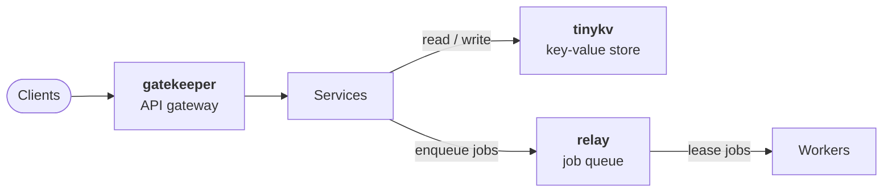

# Hi, I'm Sumit Singh

I'm a backend developer working mostly in **Go**. I like the infrastructure layer of web
services: how requests get routed, how data survives a crash, and how failed work gets
retried safely.

**Looking for remote backend roles.**

## Featured projects

Three backend systems built from scratch in Go. Each one has CI that runs the tests under the
race detector, a Docker image, and release binaries for Linux, macOS and Windows.

Where each project sits in a typical backend. Each is a standalone repo.

### [gatekeeper](https://github.com/Sumit-do/gatekeeper): API gateway

A reverse proxy that sits in front of your services, built on the Go standard library alone.

- Longest-prefix routing, round-robin load balancing and per-upstream circuit breakers that
  admit a single probe request when half-open.
- Token-bucket rate limiting per verified API key. Unknown keys get a 401, so a client cannot
  dodge the limit by inventing new keys.
- Config reload with no dropped requests through an atomic router swap, plus Prometheus
  metrics, JSON logs and graceful shutdown.

### [tinykv](https://github.com/Sumit-do/tinykv): key-value store

An embedded, persistent store based on the Bitcask design, with an HTTP server and a CLI.

- Append-only log of length-prefixed, CRC32-checksummed records, with an in-memory index so a
  read is one map lookup and one disk read.
- Crash recovery that replays the log and cuts off a torn tail. Tests cover partial, corrupt
  and zeroed records.
- Compaction that keeps serving reads and swaps files atomically, plus per-key TTL and a choice
  of fsync policies.

### [relay](https://github.com/Sumit-do/relay): durable job queue

A background job queue with at-least-once delivery that runs as one binary or embeds as a library.

- Leases with heartbeats, and fencing tokens that reject a late acknowledgement from a worker
  whose lease already expired.
- Exponential backoff with jitter, a dead-letter queue with redrive, and idempotent enqueue.
- SQLite in WAL mode behind a `Store` interface. One shared contract test suite runs against
  both the SQLite and in-memory backends.

### What they cover

| | gatekeeper | tinykv | relay |
| --- | :---: | :---: | :---: |
| Concurrency and locking | ✓ | ✓ | ✓ |
| Fault tolerance | circuit breakers | crash recovery | retries and dead-lettering |
| Persistence | | append-only log | SQLite |
| HTTP API | ✓ | ✓ | ✓ |
| Prometheus metrics | ✓ | | ✓ |
| Third-party dependencies | 0 | 0 | 1 |

## Also on GitHub

- [competitive_prog_analysis_extension](https://github.com/Sumit-do/competitive_prog_analysis_extension):
  tracks your reasoning while you solve problems on Codeforces and AtCoder, not just your verdicts.
- [codeforce_submission](https://github.com/Sumit-do/codeforce_submission): my Codeforces
  solutions in C++.
